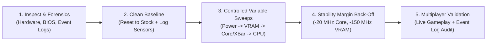

# Tuning Methodology & Objectives

## 1. Core Philosophy: Multiplayer Stability First

Most overclocking guides chase a single run of 3DMark Time Spy or Cinebench on the ragged edge of silicon stability. **This toolkit has a different objective:**

> **Maximize sustained gaming frame rates, 1% lows, and thermal/acoustic efficiency while maintaining 100% crash-free reliability across multi-hour multiplayer sessions.**

### Why Synthetic Stability $\neq$ Gaming Stability
A GPU or CPU that passes a 20-minute steady-state synthetic stress test (like FurMark or Cinebench) can still crash within 10 minutes of a modern Unreal Engine 5 or DirectX 12 game. Why?
1. **Steady-State Heavy Load (Synthetic):** Draws maximum current (`Icc`) and maximum power (`TGP`/`PPT`). The GPU/CPU drops to a **lower, thermally-limited boost bin** (e.g., `2,790 MHz` at `1.01V` on an RTX 4080, or `5.1 GHz` all-core on a CPU) where the voltage-to-frequency ratio has plenty of margin.
2. **Transient Variable Load (Gaming):** When you open an in-game map, transition scenes, or look at the sky, power draw drops to 50–70% of TGP. The boost algorithm immediately shoots to its **highest peak voltage/frequency bins** (`2,925+ MHz` on RTX 4080, `3,150+ MHz` on RTX 5080, or single-core boost on CPU) and then snaps back to heavy shader/ray-tracing load in microseconds.
   - If the high-voltage V/F bins or Crossbar (`XBar`) clocks are pushed too far—or if an aggressive negative voltage offset starves the core during the load transient (`Vdroop`)—the hardware throws an exception (`nvlddmkm` Event ID 153/14 or CPU `WHEA-Logger` Event ID 18).

---

## 2. The 5-Phase Scientific Tuning Loop

### Step 1: Forensic Audit Before Changing Anything
Before touching a single clock slider, run [`scripts/Inspect-System.ps1`](../scripts/Inspect-System.ps1) and [`scripts/Diagnose-Crashes.ps1`](../scripts/Diagnose-Crashes.ps1).
- Often, a user's system already has conflicting background remnants: an old MSI Afterburner per-point V/F curve fighting a new driver, a stale Intel XTU `PerformanceSettings.bin` failing validation on every boot, or a power plan forcing `1.38V` / `65W` at 0% idle load.

### Step 2: Establish a Clean, Reproducible Baseline
- Reset GPU clocks to factory default (`Run-GpuBenchmark.ps1 -ResetToDefault`, which writes stock offsets + 100% power via mVolt+ and verifies them with `--status`; mVolt+ itself has no `--reset` flag).
- Run a standardized 20-second Vulkan load (`Run-GpuBenchmark.ps1`) and a 20-second native Scalar + AVX2 CPU load (`SensorCli.exe --stress`).
- Record **Score, Min/Avg/Max FPS, Effective Clocks, Temperatures (Core, Hotspot, VRAM, Package, DIMMs), and Power Draw**.

### Step 3: Tune One Subsystem at a Time
Never change Core, Crossbar, Memory, and CPU settings all at once.
1. **GPU Power Envelope:** Unlock VBIOS maximum power headroom (`110%–117%` TGP) so the card isn't prematurely `Pwr`-capped during heavy scenes.
2. **GPU Memory (GDDR6X / GDDR7):** Sweep memory offset while watching **actual benchmark FPS**, not just reported clock speed. Both GDDR6X and GDDR7 use error-correcting link retraining—pushing past the sweet spot silently reduces FPS due to retry overhead before visual artifacts appear.
3. **GPU Core & Crossbar (`XBar`):** Sweep Core and `XBar` together using dynamic offset mode (`--clock-range default`) rather than a manual per-point curve.
4. **CPU Power & Thread Scheduling:** Eliminate idle heat soak while keeping gaming cores unparked and responsive (`<1ms` Speed Shift / CPPC ramp).

### Step 4: Apply the "Multiplayer Safety Buffer"
Once you find the highest setting that passes synthetic stress + artifact scanning cleanly, **step back by 1–2 bins** (`-15` to `-30 MHz` on GPU Core, `-30` to `-60 MHz` on GPU Crossbar, `-150` to `-250 MHz` on VRAM) to account for transient gaming spikes and high-voltage boost bins.

### Step 5: Real-World Validation & Persistence
Save the verified profile to auto-apply at Windows startup, have the user play their actual multiplayer game, and run `Diagnose-Crashes.ps1` afterward to verify zero hardware or driver warnings.
